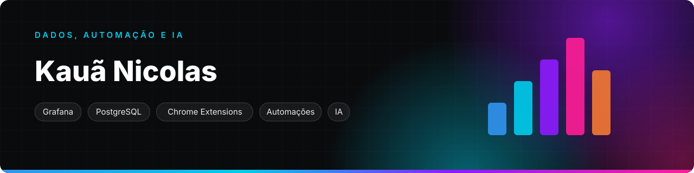

  

## E aí, eu sou o Kauã

Mexo com dados, mas não só. Se uma tarefa se repete ou algo está travando o trabalho, eu monto a ferramenta que resolve: um painel, uma extensão do Chrome, um fluxo no n8n ou uma rotina com IA que roda sozinha.

- **Dados:** Grafana e SQL
- **Extensões do Chrome:** importação, acessos e onboarding
- **Automação:** n8n, ClickUp, Slack e APIs
- **IA:** assistentes e agentes no dia a dia

Meus repositórios são privados, então aqui fica só o resumo.

